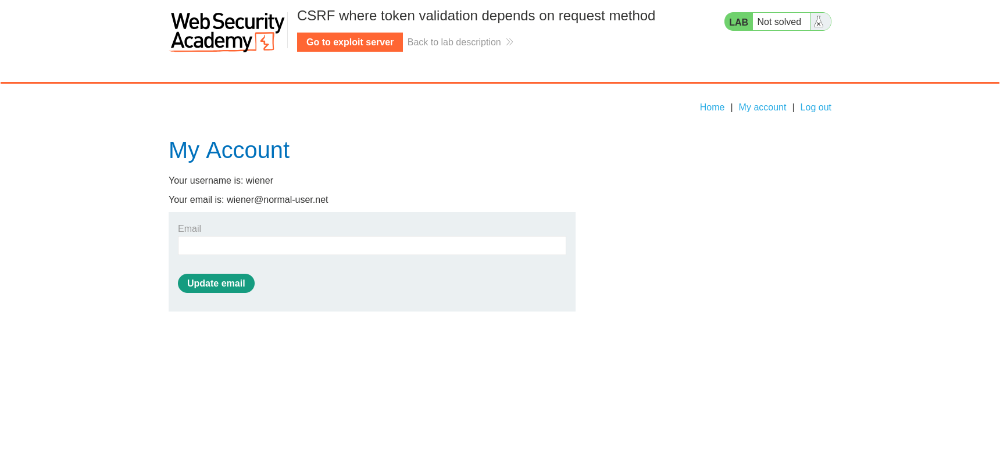
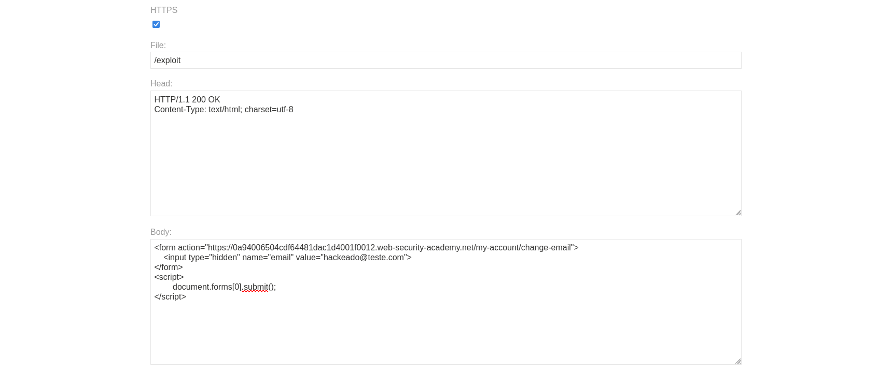
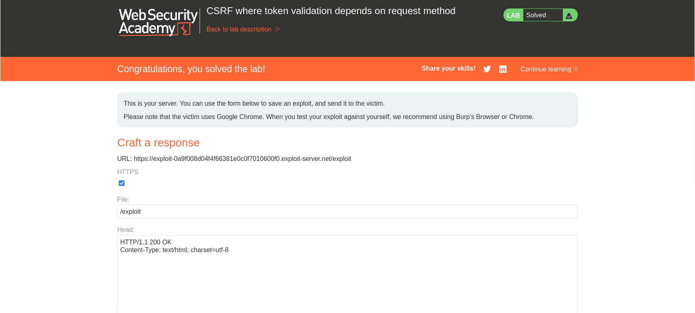

# CSRF where token validation depends on request method

> Write-up do lab da **PortSwigger Web Security Academy** sobre CSRF com validação de token que depende do método HTTP.

## Resumo

| Item | Detalhe |
|---|---|
| **Plataforma** | PortSwigger Web Security Academy |
| **Lab** | CSRF where token validation depends on request method |
| **Dificuldade** | Practitioner |
| **Categoria** | Cross-Site Request Forgery (CSRF) |
| **Classificação** | CWE-352 · OWASP Top 10 2021: A01 (Broken Access Control) |
| **Ferramentas** | Navegador, Burp Suite, Exploit Server do lab |
| **Credenciais do lab** | `wiener:peter` |

---

## Contexto e objetivo

A funcionalidade de troca de e-mail da aplicação é vulnerável a CSRF. A aplicação tenta se proteger com token anti-CSRF, mas **aplica a defesa apenas a certos tipos de requisição**.

**Objetivo:** usar o exploit server para hospedar uma página HTML que, ao ser aberta pela vítima, altere o e-mail da conta dela.

---

## Raciocínio: a falha que a teoria descreve

A própria documentação da PortSwigger, na seção *Common flaws in CSRF token validation*, descreve este cenário:

> Algumas aplicações validam corretamente o token quando a requisição usa **POST**, mas **pulam a validação** quando é usado **GET**.

Nesse caso, o atacante troca o método para GET e contorna a validação. O exemplo do material de leitura é este:

```http
GET /email/change?email=pwned@evil-user.net HTTP/1.1
Host: vulnerable-website.com
Cookie: session=2yQIDcpia41WrATfjPqvm9tOkDvkMvLm
```

A hipótese de trabalho foi, portanto:

1. O fluxo normal de troca de e-mail usa **POST** com um campo `csrf` e é protegido.
2. A validação do token pode estar vinculada ao método POST.
3. Se o endpoint aceitar **GET** com os mesmos parâmetros e sem token, o ataque funciona.

---

## Reconhecimento

Logado como `wiener`, a página **My Account** mostra o usuário e o e-mail atual, além do formulário de troca de e-mail:



Estado inicial:

- Usuário: `wiener`
- E-mail: `wiener@normal-user.net`
- Status do lab: **Not solved**

Ao interceptar a troca de e-mail no Burp Suite, o fluxo legítimo é uma requisição **POST** para `/my-account/change-email`, com os parâmetros `email` e `csrf`. A partir daí, o teste foi verificar se o endpoint também aceita o método **GET**, sem o token, seguindo a lógica descrita acima.


---

## Exploração

### Por que é necessário usar o exploit server?

Nos labs de CSRF da PortSwigger, não basta enviar a requisição manualmente pelo Burp. Um ataque CSRF só existe quando a requisição parte **do navegador da vítima**, a partir de **outro site controlado pelo atacante**. É essa característica que faz o navegador anexar **automaticamente** o cookie de sessão da vítima à requisição.

Por isso o lab fornece o **exploit server**: ele hospeda a página do atacante e simula a vítima (usando Chrome) abrindo essa página.

É também por isso que a requisição final **não aparece escrita em HTTP puro**, como no material de leitura. Lá ela é mostrada só para explicar o conceito (`GET /email/change?email=...`). No lab, quem monta e envia essa requisição é o **navegador da vítima**, a partir de um formulário HTML que eu forneço.

### Payload

No campo **Body** do exploit server, em `/exploit`:

```html
<form action="https://LAB-ID.web-security-academy.net/my-account/change-email">
    <input type="hidden" name="email" value="hackeado@teste.com">
</form>
<script>
    document.forms[0].submit();
</script>
```



### Como o payload funciona

- O `<form>` **não define o atributo `method`**. Em HTML, o método padrão de um formulário é **GET**. Os dados do campo viram parâmetros na URL, o que gera exatamente:

  ```http
  GET /my-account/change-email?email=hackeado@teste.com HTTP/1.1
  ```

- Esse GET **não carrega nenhum token CSRF**, e a aplicação o aceita porque só valida o token em requisições POST.
- O campo `email` é `hidden`, então a vítima não vê nada.
- O `<script>` envia o formulário **automaticamente** assim que a página carrega, sem nenhuma interação da vítima.
- Como a requisição sai do navegador da vítima, o **cookie de sessão é enviado junto**, e o servidor entende que a troca é legítima.

### Entrega

Com o payload salvo no exploit server (**Store**), basta usar **Deliver exploit to victim**. A vítima simulada abre a página, o formulário é enviado e o e-mail da conta dela é alterado.

### Resultado



O lab foi marcado como **Solved**.

---

## Causa raiz

A proteção anti-CSRF foi implementada **de forma condicional ao método HTTP**: o servidor só exige o token quando recebe POST. Como o endpoint `/my-account/change-email` também processa a requisição via GET, o atacante simplesmente escolhe o método que **não é validado**.

Dois problemas se somam:

1. **Validação de token incompleta**: a checagem depende do método, e não da ação sendo executada.
2. **Ação que altera estado acessível via GET**: GET deve ser seguro e idempotente (RFC 9110), mas aqui ele modifica dados da conta.

---

## Mitigação

- **Validar o token em toda requisição que altera estado**, independentemente do método HTTP. A regra deve ser "se muda estado, exige token".
- **Não permitir mudança de estado via GET**. O endpoint deve aceitar apenas POST (ou PUT/PATCH/DELETE) e rejeitar GET.
- **Usar cookies com `SameSite`** como defesa adicional. Atenção: `SameSite=Lax` **não bloqueia** requisições GET de navegação de nível superior, como a deste ataque, então ele não substitui as medidas acima. `SameSite=Strict` oferece proteção mais forte.
- **Exigir reautenticação ou confirmação** para ações sensíveis, como troca de e-mail ou senha.

---

## Lições aprendidas

- Proteger **só o caminho "oficial"** (o formulário em POST) não basta, é preciso testar **todos os métodos** que o endpoint aceita.
- Ao analisar proteção CSRF, vale testar: remover o token, alterar o token, usar o token de outro usuário e **trocar o método HTTP**.
- Em CSRF, o exploit server não é um detalhe do lab: ele representa o **site do atacante**, e é de lá que o ataque precisa partir.
- A teoria (leitura da PortSwigger) mostra a requisição crua, mas na prática ela precisa ser **construída para o navegador da vítima emitir**, e um formulário sem `method` resolve isso de forma simples.

---

## Referências

- [PortSwigger: CSRF](https://portswigger.net/web-security/csrf)
- [PortSwigger: Common flaws in CSRF token validation](https://portswigger.net/web-security/csrf/bypassing-token-validation)
- [CWE-352: Cross-Site Request Forgery](https://cwe.mitre.org/data/definitions/352.html)

